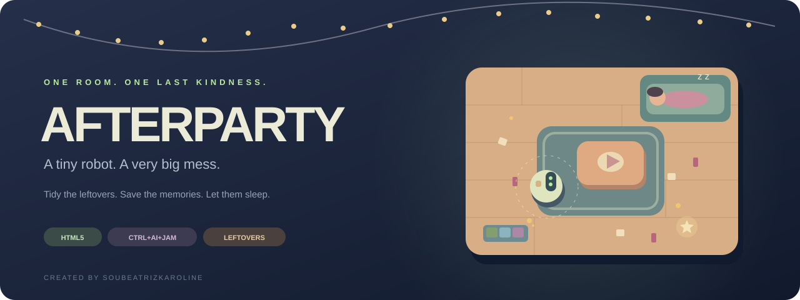
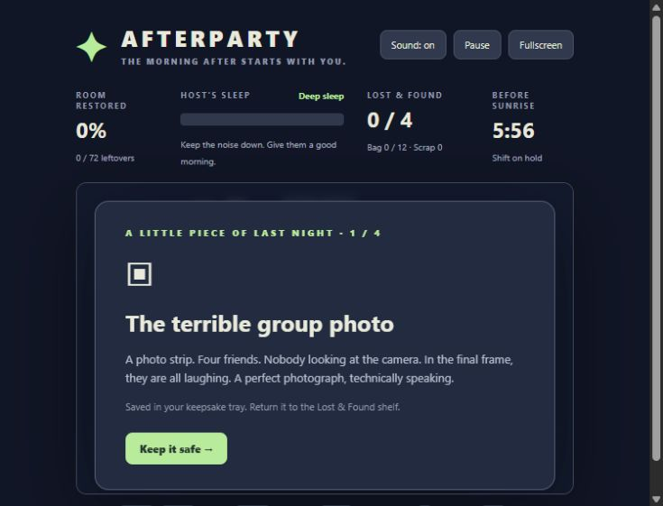

<div align="center">



**The party is over. Your shift is not.**

A cozy stealth-cleaning game about leftovers, small kindnesses,<br>and the things people leave behind.

**HTML5** · **One room** · **Six-minute shifts** · **English** · **No dependencies**

[Download the itch.io build](https://github.com/SouBeatrizKaroline/CtrlAIJam_Afterparty/raw/refs/heads/main/build/Afterparty-HTML5.zip) · [Submission copy](docs/ITCH_PAGE.md) · [Development notes](docs/DEVLOG.md)

---

</div>

## ✦ A little mess. A little meaning.

Last night was a leaving party. This morning, there are crumbs on the carpet, cups under the balloons, and a very tired human asleep on the sofa.

You are **MOP-01**: a tiny cleaning robot with a big heart. Before sunrise, restore the room, recycle what you can, and rescue four keepsakes from the mess. The room is full of leftovers. Some belong in a bin. Some deserve a place on the shelf.

> Tidy the leftovers. Save the memories. Let them sleep.

<details>
<summary><b>A little piece of last night — in-game preview</b></summary>



</details>

## 🎮 Your morning shift

| Clean | Recycle | Remember | Stay quiet |
| :--- | :--- | :--- | :--- |
| Pull **72 leftovers** into your vacuum with a satisfying swirl of particles. | Sort your bag at the dock and turn yesterday's mess into **useful upgrades**. | Find **four glowing keepsakes** that reveal the story of the party. | Watch the host's sleep meter. A loud motor or a furniture bump can wake them. |

Everything happens in **one living room**. The sofa, rug, coffee table, service dock, and Lost & Found shelf all share the same scene. Menus are overlays over that room.

**To finish your shift:** collect all 72 leftovers, sort every item in your bag, and return all four keepsakes to the Lost & Found shelf before sunrise. If the noise meter fills up or the clock runs out, try another shift.

## ⌨️ Controls

| Action | Keyboard |
| :--- | :--- |
| Move | **WASD** or **arrow keys** |
| Vacuum | Hold **Space** |
| Quiet mode | Hold **Shift** |
| Find a keepsake / use the dock / return keepsakes | **E** |
| Choose a sorting bin | **1**, **2**, **3**, or click |
| Pause / resume | **Esc** or the Pause button |
| Fullscreen | Entered on **Clock in** when the browser permits it; also available in the header |
| Sound | Toggle in the header |

Touch devices also get a directional pad, a vacuum button, a quiet-mode toggle, and an interact button. Desktop keyboard play is the primary experience.

**A softer approach pays off:** quiet mode slows movement and suction, but makes far less noise. The sofa amplifies noise, so take your time around your human. Let go of the vacuum to let their sleep settle. Sorting, keepsake reading, upgrades, and pause screens stop the clock.

## 🔧 Give yesterday a second life

Sorting into the right bin earns **2 scrap**; the wrong bin earns **1 scrap** and adds noise. No item is permanently lost.

| Upgrade | Cost | What changes |
| :--- | ---: | :--- |
| **Wide-mouth nozzle** | 12 scrap | Vacuum reaches roughly 50% farther. |
| **Soft little motor** | 15 scrap | Vacuum makes 45% less noise. |
| **Bigger-on-the-inside bag** | 10 scrap | Bag capacity increases from 12 to 24. |

Upgrades last for the current shift. A fresh shift starts with a fresh robot and the same handcrafted room layout.

## ▶️ Play locally

**Just play:** download [Afterparty-HTML5.zip](https://github.com/SouBeatrizKaroline/CtrlAIJam_Afterparty/raw/refs/heads/main/build/Afterparty-HTML5.zip), extract it, and open `index.html` in a modern browser. The game has no network requests, asset downloads, API keys, or installation requirements.

**For development**, install Node.js 18 or newer, then run:

```sh
git clone https://github.com/SouBeatrizKaroline/CtrlAIJam_Afterparty.git
cd CtrlAIJam_Afterparty
npm start
```

Open **http://localhost:4173**. There is no dependency installation step.

```sh
npm test     # Check game rules, reachability, upgrades, and outcomes
npm run build # Produce build/Afterparty-HTML5.zip
```

## 🏁 Made for Ctrl+AI+Jam — Week 01

| Jam requirement | Afterparty's interpretation |
| :--- | :--- |
| **LEFTOVERS** | Party waste becomes upgrades. Forgotten belongings become a story about friendship and leaving home. |
| **ONE ROOM** | The entire game takes place in a single living room, with a fixed camera and no level transitions. |
| **Don't Wake It** | The player must keep noise down around the sleeping host. |
| **Browser build** | A self-contained HTML5 ZIP with `index.html` at the top level. |
| **Fresh project** | Created for this jam from an empty repository. |

### Upload to itch.io

1. Create a game project and select **HTML** as the kind of project.
2. Upload **`build/Afterparty-HTML5.zip`** and tick **“This file will be played in the browser.”**
3. Start with an embed size of **1120 × 860**, and enable the fullscreen button. The layout adapts to smaller desktop embeds and fullscreen viewports.
4. Use [the prepared English description](docs/ITCH_PAGE.md), including **AI Tools Used** and **Flavor Cards**.
5. Play the uploaded build on the itch.io page once. Check the menu, movement, vacuum, sorting, keepsakes, upgrades, restart, audio toggle, and fullscreen.
6. Submit the itch.io project to the jam. Check the live jam page for the deadline and join the organizers' Discord if claiming prize eligibility.

**The GitHub upload is not the jam submission.** The ZIP still needs to be uploaded and tested on itch.io.

## 🤖 AI Tools Used

**OpenAI Codex** assisted with concept development, JavaScript gameplay programming, procedural Canvas artwork, interface styling, synthesized sound effects, automated tests, documentation, and packaging.

**Human direction — SouBeatrizKaroline:** selected the Afterparty concept and directed the English-language presentation, repository naming, fullscreen experience, and publication. The project was developed iteratively with gameplay checks and visual review; it is not a single unreviewed prompt export.

All room art is drawn directly in Canvas using geometric shapes and a consistent palette. Sound effects are synthesized through the Web Audio API. No generated raster assets, stock asset packs, copyrighted characters, external music, or runtime AI services are used.

## 🧪 Validation

The automated suite checks reachable collectibles, bag capacity, quiet-mode noise reduction, sleep recovery, correct and incorrect sorting, upgrade costs, complete victory requirements, both defeat conditions, restart, and paused clocks. Movement and vacuum collection were also checked in a desktop browser. The itch.io embedded build must still be tested after upload.

## 🗂️ Inside the little machine

```text
index.html              Accessible interface and game shell
style.css               Responsive layout and fullscreen styling
game.js                 Gameplay, Canvas art, input, and audio
build/Afterparty-HTML5.zip  Ready-to-upload browser build
docs/cover.svg          Original repository cover illustration
docs/ITCH_PAGE.md       English itch.io description
docs/DEVLOG.md          Iteration notes and test coverage
tests/game.test.cjs     Gameplay checks
tools/serve.cjs         Local preview server
tools/build.cjs         Dependency-free HTML5 ZIP packaging
```

---

<div align="center">

**Created by [SouBeatrizKaroline](https://github.com/SouBeatrizKaroline)**<br>
<sub>Some things are not leftovers.</sub>

</div>
